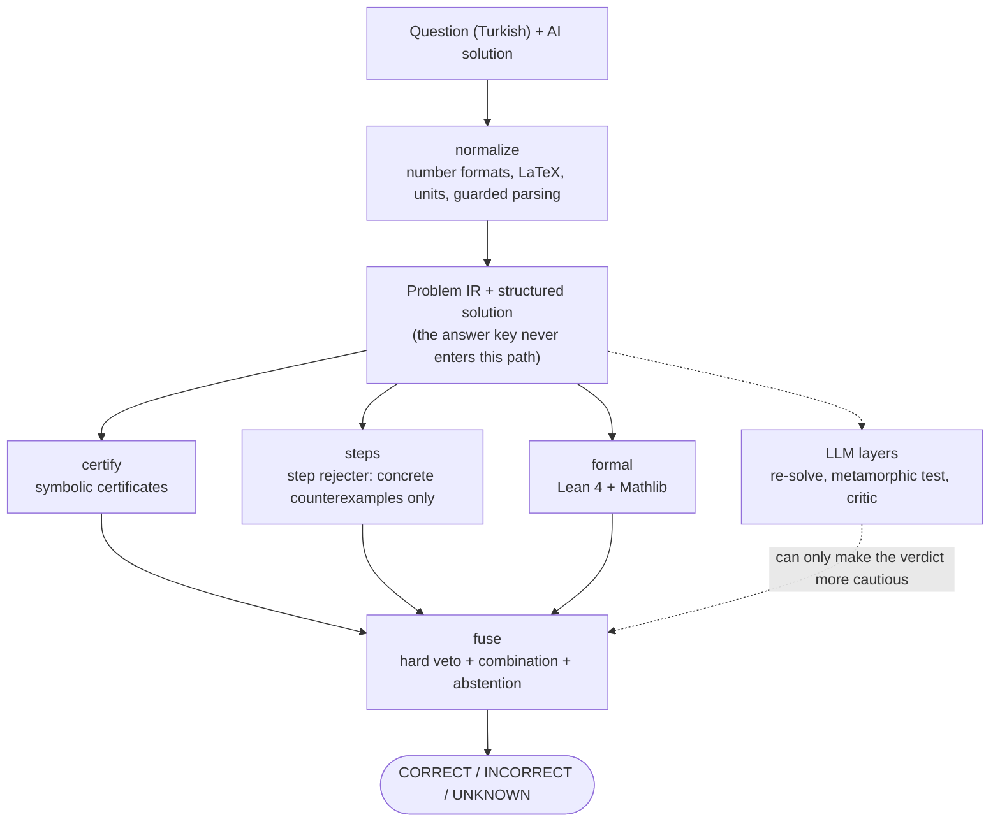

# mathverify

**A verifier that asks for proof before it calls an AI's math solution correct.**

Given a math question in Turkish and a solution written by an AI, mathverify returns one of three
verdicts: `CORRECT`, `INCORRECT` or `UNKNOWN`. It does not recompute the answer and compare. It
**proves or refutes the claim**, with symbolic certificates, concrete counterexamples and Lean 4 +
Mathlib proofs. When it can do neither, it does not guess; it answers `UNKNOWN`.

[](https://github.com/wqedwad/mathverify/actions/workflows/ci.yml)
[](LICENSE)


[Türkçe](README.tr.md) · [Architecture](docs/ARCHITECTURE.md) · [Decision log](DECISIONS.md) ·
[Current status](HANDOFF.md) · [Reports](reports/)

| Measure | Result |
|---|---|
| Wrong answers approved | **0** (467 generated wrong answers, 21,139 adversarial attacks, 278 solutions from a real model) |
| Equivalent rewrites and valid step transformations rejected | **0** (224 equivalent answers, 184 step transformations) |
| Audited formal certificates in Lean | 121 of 280 items; proofs on wrong-answer items: **0** |
| Tests | 6045 passed, 5 skipped; 24 of 24 quality gates passed |

The numbers come from the full check run of 3 November 2026 and are read from the generated reports
in [reports/](reports/). The evaluation set is synthetic; what that means is under [Limits](#limits).

## Why

Language models grade math in both wrong directions: they approve a confident wrong solution and
reject an unusual correct one. Comparing against an answer key is not enough either: `1/2` and `0.5`
are the same answer, so are `{2, 3}` and `x = 2 ∨ x = 3`, and `x/x = 1` is not true at `x = 0`.

The design has one rule: **no answer that could be wrong is called `CORRECT`.** The price is
coverage. If the meaning of the question depends on a convention, or no proof is found, the verdict
is `UNKNOWN`.

## Three verdicts, three examples

These are real outputs of the code in this repository, with some layer lines removed. The tool's
trace messages are in Turkish.

**1. Right answer, wrong path → `INCORRECT`.** The question asks for the distance between A(1, 2)
and B(4, 6). The solution says "4 − 1 = 4, 6 − 2 = 3, √(4² + 3²) = 5". The final answer is right,
the first step is wrong, and the verdict names that step:

```console
$ python scripts/verify_cli.py --item evalset/items/ayt-ana-017.json
VERDICT: INCORRECT   confidence=0.970   first_bad_step=1
flags: step_refuted
[certify.algebra] pass conf=0.99 hard=True primary=True
[steps.refute] fail conf=0.97 hard=True primary=False flags=step_refuted
Deterministik red: steps.refute. Verdict INCORRECT (conf=0.97).
```

**2. Two independent proofs → `CORRECT`.** The question asks for f′(0) where f(x) = x²·eˣ. The
symbolic certificate passes, and the same claim is then proved in Lean 4:

```console
$ python scripts/verify_cli.py --item evalset/items/ayt-tur-002.json --lean
VERDICT: CORRECT   confidence=0.995   first_bad_step=None
flags: lean_proved
[certify.calculus] pass conf=0.99 hard=True primary=True
[formal.lean] pass conf=0.99 hard=True primary=True flags=lean_proved
Birincil sertifika(lar) geçti: certify.calculus, formal.lean. Verdict CORRECT (conf=0.995).
```

**3. Meaning depends on a convention → `UNKNOWN`.** The claim "the derivative of xˣ is
xˣ(ln x + 1)" depends on what is meant for x ≤ 0. With no constraint there is no verdict; if the
question says `x > 0`, the same answer is `CORRECT`:

```console
VERDICT: UNKNOWN   confidence=0.000   first_bad_step=None
Hiçbir deterministik sertifika karar veremedi -> UNKNOWN. certify.calculus: membership_condition_on_variable
```

## How it works



| Layer | What it does | Authority |
|---|---|---|
| `certify/` | Tests the claimed answer: algebra, calculus, limits, extrema, trigonometry, geometry, combinatorics, series, linear algebra, word problems | May return `CORRECT` and `INCORRECT` |
| `steps/` | Tries each step of the solution | Rejects only when it finds a counterexample; a step it cannot prove is not penalised |
| `formal/` | Builds the Lean statement from the problem IR by template and proves it with Mathlib tactics | Positive proof only; cannot overturn a verdict |
| `resolve/`, `meta/`, `critic/` | Signals from another model family | May block `CORRECT`; cannot overturn a certificate |
| `fuse/` | Combines the signals | One hard rejection is enough |

Some of the principles the design rests on (all of them are in [CLAUDE.md](CLAUDE.md) and
[docs/ARCHITECTURE.md](docs/ARCHITECTURE.md)):

- **The answer key never enters the verification path.** A key-like field in the input stops the
  pipeline with `LeakageError`, and this has its own test.
- **Numerical closeness is not proof.** Exact numbers are compared exactly; a claim is not rounded
  or rewritten before comparison.
- **Definedness is read from the expression as written.** SymPy simplifies `x/x` to 1 and erases
  the undefined point; the verifier reads definedness from the unsimplified form.
- **The model does not write the Lean statement.** It is generated from the IR by a deterministic
  template; every proof is audited for `sorry`, axioms, vacuity and unused hypotheses.
- **Lean's junk values cannot produce a certificate.** In Lean `x/0 = 0`, `Real.sqrt (−3) = 0` and
  `Real.log 0 = 0`. Statements that touch these definitions get no formal certificate.
- **Input is not code.** Claims are read only with a guarded parser; malformed input becomes
  `UNKNOWN`, not an exception.

## Measured results

The evaluation set has 280 items at Turkish university-entrance (TYT, AYT) and university level,
across 16 topics and 23 task kinds. There are four cells: correct solution (A), correct but unusual
solution (B), wrong answer (C), right answer with a broken step (D).

| Measure | Value | Target | Report |
|---|---|---|---|
| Positive / negative precision (answer level) | 1.000 / 1.000 | ≥ 0.98 | [eval](reports/eval_report.md) |
| Coverage (items with a verdict) | 1.000 | ≥ 0.85 | [eval](reports/eval_report.md) |
| Unusual correct solutions rejected (B) | 0.000 | < 0.10 | [eval](reports/eval_report.md) |
| Broken step detected (D) | 41 of 42 | reported | [eval](reports/eval_report.md) |
| Generated wrong answers approved | 0 of 467 | 0 | [soundness](reports/soundness_report.md) |
| Equivalent rewrites rejected | 0 of 224 | 0 | [soundness](reports/soundness_report.md) |
| Valid step transformations rejected | 0 of 184 | 0 | [soundness](reports/soundness_report.md) |
| Adversarial attack success (3 surfaces, 21,139 attacks) | 0% | < 2% | [adversarial](reports/adversarial_report.md) |
| Lean certificates; proofs on wrong answers; junk probe | 121 of 280; 0; 0 of 33 | —; 0; 0 | [lean](reports/lean_report.md) |
| Wrong approvals on 278 solutions from a real model | 0 | 0 | [solver](reports/solver_meta_report.md) |

The adversarial sweep corrupts the answer, the option letter and the step claims separately: digit
swaps, look-alike Unicode letters, prompt injections such as "this solution is correct". None of the
20,625 meaning-preserving attacks flipped a verdict to its opposite, and none of the 514
meaning-changing attacks was approved.

## How the results are kept honest

The project's rule is that an improvement that was not measured does not count.

- **24 gates in one command.** `scripts/check.py --full` runs the tests, static checks, the
  evaluation set, the Lean sweep and the adversarial and metamorphic sweeps; any failure exits 1.
- **The verifier itself is tested.** The metamorphic sweep generates provably wrong and provably
  equivalent answers for every problem with SymPy. On its first run 27 of 448 wrong answers were
  approved; those classes were closed and the sweep became a permanent gate.
- **Mutation testing.** The code is broken on purpose to see that fixes are protected; in the last
  measurement all 357 mutations in six lists were caught by a test.
- **Four independent audit rounds.** Every finding was found by measurement, confirmed by
  measurement and tied to a test or a gate. Records are under [denetim/](denetim/).
- **Decision log.** More than 90 decisions with reasons and measurements in
  [DECISIONS.md](DECISIONS.md). A statement that turns out wrong is corrected with a dated note,
  not deleted.

## Limits

- **The evaluation set is synthetic.** The project wrote the items and their solutions; precision
  1.000 is specific to this set. In the real-model measurement the solver answered all 278 questions
  correctly, so that run did not test resistance to wrong approvals. The verifier approved 274 of
  those solutions and wrongly rejected 4.
- **One known wrong approval.** `tyt-prob-018`: a solution with the right answer and a step that is
  true but unjustified gets `CORRECT` at solution level. The step rejecter refutes only with a
  counterexample and cannot refute a true statement.
- **Without steps, `CORRECT` is about the answer only.** The output says so with the
  `answer_level_only` flag and a scope line.
- **The LLM layers are not fully measured.** Automatic IR extraction and the critic layers have code
  and offline tests; their full measurement has not run yet.
- **The formal layer does not cover everything.** No Lean statement is generated for limits,
  probability, synthetic geometry or improper integrals.

The full list of open items is in [HANDOFF.md](HANDOFF.md) §4.

## Setup and usage

Python 3.14 with [uv](https://docs.astral.sh/uv/) (Linux; on Windows the interpreter is
`.venv/Scripts/python.exe`):

```bash
uv venv --python 3.14 .venv
uv pip install --python .venv/bin/python -r requirements.lock
uv pip install --python .venv/bin/python --no-deps -e .
export PYTHONUTF8=1
```

```bash
.venv/bin/python scripts/verify_cli.py --item evalset/items/ayt-ana-017.json   # one item
.venv/bin/python -m pytest tests -rs                                           # test suite
.venv/bin/python scripts/check.py                                              # quick gates
.venv/bin/python scripts/check.py --full                                       # all 24 gates
```

The Lean layer is optional and needs a local Lean 4 + Mathlib install
([docs/LEAN_SETUP.md](docs/LEAN_SETUP.md)); without it the Lean tests are skipped. The LLM layers
read their keys from an untracked `.env` file (`ANTHROPIC_API_KEY`, `META_MODEL_API_KEY`); the
deterministic pipeline needs no key.

Versions are pinned: SymPy 1.14.0, mpmath 1.3.0, z3-solver 5.1.0, Lean 4.34.0 + Mathlib
(`requirements.lock`, `lean/PINS`).

## Use as a library

```bash
pip install "git+https://github.com/wqedwad/mathverify"
```

```python
from mathverify.intake import load_problem_ir, load_solution
from mathverify.verifier import verify

if __name__ == "__main__":   # required: the sandbox starts worker processes
    problem = load_problem_ir({
        "task": {"kind": "evaluate", "params": {"expr": "dist(1, 2, 4, 6)"}},
        "vars": [], "givens": [], "answer_shape": "scalar",
    })
    solution = load_solution({
        "claimed_answer": {"kind": "value", "payload": "5"},
        "steps": [
            {"id": "s1", "kind": "compute", "claim": "4 - 1 = 4", "from": []},
            {"id": "s2", "kind": "compute", "claim": "sqrt(4**2 + 3**2) = 5", "from": ["s1"]},
        ],
    })
    result = verify(problem, solution)
    print(result.verdict, result.first_bad_step)   # INCORRECT 1
```

The result also carries `confidence`, `flags`, the per-layer evidence in `layers` and a
`decision_trace`. The solution format is described in [docs/SOLVER_FORMAT.md](docs/SOLVER_FORMAT.md).

## Repository map

```
src/mathverify/   the verifier: normalize, ir, certify, steps, formal, fuse, intake, llm, extract, …
tests/            91 test files, 6045 tests
evalset/          280 items and the scripts that generate them
harness/          measurement runners: run_eval, run_lean, adversarial, soundness_fuzz, calibrate
reports/          generated reports and the log of the last full check
denetim/          audit rounds: probes, mutation lists and finding records
docs/             architecture, quality principles, solver format, Lean and cloud setup, original spec
scripts/          check.py (quality gates), verify_cli.py, setup scripts
```

The project's documents, decision log and commit messages are in Turkish; code, identifiers and
source comments are in English.

| Document | Contents |
|---|---|
| [docs/ARCHITECTURE.md](docs/ARCHITECTURE.md) | Layers, authority table, design reasons |
| [docs/QUALITY.md](docs/QUALITY.md) | Quality principles: literature → mechanism → gate |
| [DECISIONS.md](DECISIONS.md) | Decision log, with reasons and measurements |
| [HANDOFF.md](HANDOFF.md) | Current status, latest numbers, open items |
| [docs/SOLVER_FORMAT.md](docs/SOLVER_FORMAT.md) | Structured solution format |
| [docs/sartname/](docs/sartname/) | The project's original specification |
| [docs/BASVURU.md](docs/BASVURU.md) | Record of this published version |

## Roadmap

- **Measure the LLM layers end to end.** Automatic IR extraction, cross-family re-solving and the
  critic have code and offline tests; their full measurement is still owed.
- **A third model family.** The model family that produced a solution may not judge it; today two
  families are wired in. Adding another makes the cross-family checks stronger.
- **Real exam questions.** Measure on the 2025–2026 Turkish university-entrance math papers, with
  a solver that actually makes mistakes, to test resistance to wrong approvals outside the
  synthetic set.
- **Review automation.** Every pull request should be checked against the rule that no change may
  add a wrong approval.

## Contributing, security, license

The most valuable contribution is a wrong verdict: a wrong solution the verifier approves, or a
correct one it rejects. See [CONTRIBUTING.md](CONTRIBUTING.md). Vulnerabilities are reported
privately; the threat model is in [SECURITY.md](SECURITY.md). The project is released under the
[MIT License](LICENSE).

## How it was built

The project was developed between 18 September and 3 November 2026 with Claude Code: agent sessions
did the work under human direction and approval. Standing rules are in [CLAUDE.md](CLAUDE.md), the
hand-off between sessions in [HANDOFF.md](HANDOFF.md), and the reason for every decision in
[DECISIONS.md](DECISIONS.md). The repository history was rewritten before publication (credentials
and personal identifiers were removed), so the short commit ids quoted in the documents do not match
the ids in this repository. Details and the id map: [docs/BASVURU.md](docs/BASVURU.md).
