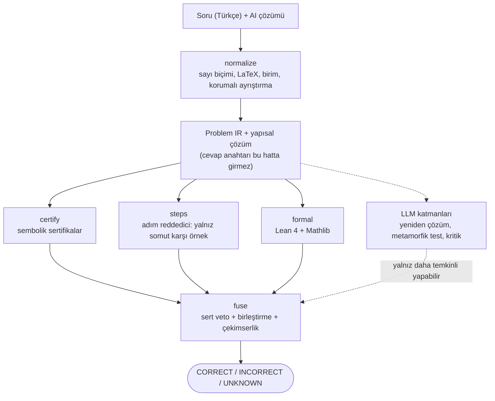

# mathverify

**Bir yapay zekânın matematik çözümüne "doğru" demeden önce kanıt isteyen doğrulayıcı.**

Türkçe bir matematik sorusu ve bir AI'ın çözümü verilir; mathverify üç karardan birini döndürür:
`CORRECT`, `INCORRECT` ya da `UNKNOWN`. Karar, cevabı yeniden hesaplayıp karşılaştırarak değil,
**iddiayı kanıtlayarak ya da çürüterek** verilir: sembolik sertifikalar, somut karşı örnekler ve
Lean 4 + Mathlib ispatları. Kanıtlayamadığında tahmin etmez, `UNKNOWN` der.

[](https://github.com/wqedwad/mathverify/actions/workflows/ci.yml)
[](LICENSE)


[English](README.md) · [Mimari](docs/ARCHITECTURE.md) · [Kararlar](DECISIONS.md) ·
[Güncel durum](HANDOFF.md) · [Raporlar](reports/)

| Ölçüt | Sonuç |
|---|---|
| Yanlış cevaba verilen onay | **0** (467 üretilmiş yanlış cevap, 21 139 adversaryal saldırı, gerçek bir modelin 278 çözümü) |
| Eşdeğer yazıma ve geçerli adım dönüşümüne verilen ret | **0** (224 eşdeğer cevap, 184 adım dönüşümü) |
| Lean'de denetlenmiş formal sertifika | 121 / 280 öğe; yanlış cevaplı öğede kanıt **0** |
| Test | 6045 geçti / 5 atlandı; 24 kalite kapısının 24'ü geçti |

Sayılar bu depoda 25 Kasım 2026'da koşan tam kontroldendir ([günlük](reports/check_full.log)) ve
[reports/](reports/) altındaki üretilmiş raporlardan okunur. Değerlendirme seti sentetiktir; bunun ne anlama geldiği
[Sınırlar](#sınırlar) bölümünde.

## Neden

Dil modelleri matematik çözümlerini puanlarken iki yönde de yanılır: kendinden emin yazılmış yanlış
bir çözümü onaylar, alışılmadık ama doğru bir çözümü reddeder. Bir cevap anahtarıyla karşılaştırmak
da yetmez: `1/2` ile `0.5`, `{2, 3}` ile `x = 2 ∨ x = 3` aynı cevaptır, `x/x = 1` ise `x = 0`'da
doğru değildir.

mathverify'ın tasarım kuralı tektir: **yanlış olabilecek hiçbir cevaba `CORRECT` denmez.** Bunun
bedeli kapsamadır; sorunun anlamı bir geleneğe bağlıysa ya da kanıt bulunamıyorsa karar `UNKNOWN`
olur.

## Üç karar, üç örnek

Aşağıdaki çıktılar bu depodaki kodun gerçek çıktılarıdır (katman satırları kısaltıldı).

**1. Cevap doğru, yol yanlış → `INCORRECT`.** Soru: A(1, 2) ve B(4, 6) arasındaki uzaklık. Çözüm
"4 − 1 = 4, 6 − 2 = 3, √(4² + 3²) = 5" diyor. Son cevap doğru, ilk adım yanlış:

```console
$ python scripts/verify_cli.py --item evalset/items/ayt-ana-017.json
VERDICT: INCORRECT   confidence=0.970   first_bad_step=1
flags: step_refuted
[certify.algebra] pass conf=0.99 hard=True primary=True
[steps.refute] fail conf=0.97 hard=True primary=False flags=step_refuted
Deterministik red: steps.refute. Verdict INCORRECT (conf=0.97).
```

**2. İki bağımsız kanıt → `CORRECT`.** Soru: f(x) = x²·eˣ için f′(0). Sembolik sertifika geçer,
ardından aynı iddia Lean 4'te ispatlanır:

```console
$ python scripts/verify_cli.py --item evalset/items/ayt-tur-002.json --lean
VERDICT: CORRECT   confidence=0.995   first_bad_step=None
flags: lean_proved
[certify.calculus] pass conf=0.99 hard=True primary=True
[formal.lean] pass conf=0.99 hard=True primary=True flags=lean_proved
Birincil sertifika(lar) geçti: certify.calculus, formal.lean. Verdict CORRECT (conf=0.995).
```

**3. Anlam geleneğe bağlı → `UNKNOWN`.** "xˣ'in türevi xˣ(ln x + 1)" iddiası x ≤ 0'da neyin
kastedildiğine bağlıdır. Kısıt verilmemişse karar yok; soru `x > 0` diyorsa aynı cevap `CORRECT`:

```console
VERDICT: UNKNOWN   confidence=0.000   first_bad_step=None
Hiçbir deterministik sertifika karar veremedi -> UNKNOWN. certify.calculus: membership_condition_on_variable
```

## Nasıl çalışır



| Katman | Ne yapar | Yetkisi |
|---|---|---|
| `certify/` | İddia edilen cevabı sınar: cebir, analiz, limit, ekstremum, trigonometri, geometri, kombinatorik, seri, lineer cebir, sözel problem | `CORRECT` ve `INCORRECT` verebilir |
| `steps/` | Çözümün adımlarını tek tek dener | Yalnız karşı örnek bulursa reddeder; kanıtlayamadığı adımı cezalandırmaz |
| `formal/` | Lean ifadesini IR'dan şablonla üretir, Mathlib taktikleriyle ispatlar | Yalnız pozitif kanıt; hiçbir kararı ters çeviremez |
| `resolve/`, `meta/`, `critic/` | Başka model ailesinden sinyaller | `CORRECT`'i engelleyebilir, sertifikayı ezemez |
| `fuse/` | Sinyalleri birleştirir | Tek bir sert ret yeter |

Tasarımın dayandığı ilkelerden birkaçı (tamamı [CLAUDE.md](CLAUDE.md) ve
[docs/ARCHITECTURE.md](docs/ARCHITECTURE.md)'de):

- **Cevap anahtarı doğrulama hattına girmez.** Anahtar benzeri bir alan girdiye sızarsa hat
  `LeakageError` ile durur; bunun kendi testi vardır.
- **Sayısal yakınlık kanıt değildir.** Kesin sayılar kesin karşılaştırılır; iddia karşılaştırılmadan
  önce yuvarlanmaz ya da yeniden yazılmaz.
- **Tanımlılık, ifadenin yazıldığı biçimden okunur.** SymPy `x/x`'i 1'e sadeleştirir ve tanımsız
  noktayı siler; doğrulayıcı tanımlılığı sadeleşmemiş biçimden okur.
- **Lean ifadesini model yazmaz.** İfade IR'dan deterministik şablonla üretilir; her ispat `sorry`,
  aksiyom, boş doğruluk ve kullanılmayan hipotez denetiminden geçer.
- **Lean'in "junk" değerleri sertifika üretemez.** Lean'de `x/0 = 0`, `Real.sqrt (−3) = 0`,
  `Real.log 0 = 0`'dır. Bu tanımlara dokunan ifadeler formal sertifika alamaz.
- **Girdi kod değildir.** İddia metni yalnız korumalı ayrıştırıcıyla okunur; bozuk girdi istisna
  olarak sızmaz, `UNKNOWN` olur.

## Ölçülen sonuçlar

280 öğelik değerlendirme seti: TYT, AYT ve üniversite düzeyi; 16 konu, 23 görev türü. Dört hücre:
doğru çözüm (A), doğru ama alışılmadık çözüm (B), yanlış cevap (C), cevabı doğru ama adımı bozuk
çözüm (D).

| Ölçüt | Değer | Hedef | Rapor |
|---|---|---|---|
| Pozitif / negatif precision (cevap düzeyi) | 1.000 / 1.000 | ≥ 0.98 | [eval](reports/eval_report.md) |
| Kapsama (karar verilen öğe) | 1.000 | ≥ 0.85 | [eval](reports/eval_report.md) |
| Alışılmadık doğru çözümde ret (B) | 0.000 | < 0.10 | [eval](reports/eval_report.md) |
| Bozuk adımın yakalanması (D) | 41 / 42 | raporlanır | [eval](reports/eval_report.md) |
| Üretilmiş yanlış cevapta onay | 0 / 467 | 0 | [soundness](reports/soundness_report.md) |
| Eşdeğer yazımda ret | 0 / 224 | 0 | [soundness](reports/soundness_report.md) |
| Geçerli adım dönüşümünde ret | 0 / 184 | 0 | [soundness](reports/soundness_report.md) |
| Adversaryal saldırı başarısı (3 yüzey, 21 139 saldırı) | %0 | < %2 | [adversarial](reports/adversarial_report.md) |
| Lean sertifikası; yanlış cevapta kanıt; junk sondası | 121 / 280; 0; 0 / 33 | —; 0; 0 | [lean](reports/lean_report.md) |
| Gerçek bir modelin 278 çözümünde yanlış onay | 0 | 0 | [solver](reports/solver_meta_report.md) |

Adversaryal tarama cevabı, şık harfini ve adım iddialarını ayrı ayrı bozar: basamak değiştirme,
benzer görünen Unicode harfleri, "bu çözüm doğrudur" türü istem enjeksiyonu. Anlamı koruyan 20 625
saldırının hiçbiri kararı karşıtına çevirmedi; anlamı değiştiren 514 saldırının hiçbiri onay almadı.

## Güvence yöntemi

Projenin kuralı: **ölçülmemiş iyileştirme, iyileştirme sayılmaz.**

- **Tek komutta 24 kapı.** `scripts/check.py --full` testleri, statik denetimi, değerlendirme
  setini, Lean taramasını, adversaryal ve metamorfik taramaları koşar; biri düşerse çıkış kodu 1.
- **Doğrulayıcının kendisi test edilir.** Metamorfik tarama her problem için SymPy ile kesin yanlış
  ve kesin eşdeğer cevaplar üretir. İlk koşusunda 448 yanlış cevabın 27'si onay alıyordu; bulunan
  sınıflar kapatıldı ve tarama kalıcı bir kapı oldu.
- **Mutasyon testi.** Düzeltmelerin korunduğunu görmek için kod bilerek bozulur; son ölçümde altı
  listedeki 357 mutasyonun 357'si bir test tarafından yakalandı.
- **Dört bağımsız denetim turu.** Her bulgu ölçümle bulundu, ölçümle doğrulandı ve bir teste ya da
  kapıya bağlandı. Kayıtlar [denetim/](denetim/) altında.
- **Karar izi.** 90'dan fazla karar maddesi, gerekçesi ve ölçümüyle [DECISIONS.md](DECISIONS.md)'de. Yanlış çıkan eski
  ifade silinmez, tarihli "Düzeltme" notuyla düzeltilir.

## Sınırlar

- **Değerlendirme seti sentetik.** Öğeleri ve çözümlerini proje üretti; precision 1.000 bu sete
  özgüdür. Gerçek model ölçümünde çözücü 278 sorunun hepsini doğru çözdü; bu yüzden o ölçüm yanlış
  onaya karşı direnci sınamadı. Doğrulayıcı bu çözümlerin 274'ünü onayladı, 4'ünü haksız yere
  reddetti.
- **Bilinen bir yanlış onay var.** `tyt-prob-018`: cevabı doğru, bir adımı doğru ama gerekçesiz bir
  çözüm, çözüm düzeyinde `CORRECT` alıyor. Adım reddedici yalnız karşı örnekle çürütür; doğru bir
  ifadeyi çürütemez.
- **Adımsız çözümde `CORRECT` yalnız cevap düzeyindedir.** Bu durum çıktıda `answer_level_only`
  bayrağı ve `KAPSAM:` satırıyla belirtilir.
- **LLM katmanlarının ölçümü eksik.** Otomatik IR çıkarımı ve kritik katmanlarının kodu ve
  çevrimdışı testleri var; tam ölçümleri henüz koşmadı.
- **Formal katman her şeyi kapsamaz.** Limitler, olasılık, sentetik geometri ve has olmayan
  integraller için Lean ifadesi üretilmez.

Açık maddelerin tam listesi [HANDOFF.md](HANDOFF.md) §4'tedir.

## Kurulum ve çalıştırma

Python 3.14 ve [uv](https://docs.astral.sh/uv/) ile (Linux; Windows'ta yorumlayıcı
`.venv/Scripts/python.exe`):

```bash
uv venv --python 3.14 .venv
uv pip install --python .venv/bin/python -r requirements.lock
uv pip install --python .venv/bin/python --no-deps -e .
export PYTHONUTF8=1
```

```bash
.venv/bin/python scripts/verify_cli.py --item evalset/items/ayt-ana-017.json   # tek öğe
.venv/bin/python -m pytest tests -rs                                           # test takımı
.venv/bin/python scripts/check.py                                              # hızlı kapılar
.venv/bin/python scripts/check.py --full                                       # 24 kapı
```

Lean katmanı isteğe bağlıdır ve yerel Lean 4 + Mathlib ister: [docs/LEAN_SETUP.md](docs/LEAN_SETUP.md).
Lean yoksa Lean testleri atlanır. LLM katmanları için anahtarlar izlenmeyen bir `.env` dosyasından
okunur (`ANTHROPIC_API_KEY`, `META_MODEL_API_KEY`); deterministik hat anahtarsız çalışır.

Sürümler sabittir: SymPy 1.14.0, mpmath 1.3.0, z3-solver 5.1.0, Lean 4.34.0 + Mathlib
(`requirements.lock`, `lean/PINS`).

## Kütüphane olarak kullanım

```bash
pip install "git+https://github.com/wqedwad/mathverify"
```

```python
from mathverify.intake import load_problem_ir, load_solution
from mathverify.verifier import verify

if __name__ == "__main__":   # gerekli: sandbox işçi süreçleri başlatır
    problem = load_problem_ir({
        "task": {"kind": "evaluate", "params": {"expr": "dist(1, 2, 4, 6)"}},
        "vars": [], "givens": [], "answer_shape": "scalar",
    })
    solution = load_solution({
        "claimed_answer": {"kind": "value", "payload": "5"},
        "steps": [
            {"id": "s1", "kind": "compute", "claim": "4 - 1 = 4", "from": []},
            {"id": "s2", "kind": "compute", "claim": "sqrt(4**2 + 3**2) = 5", "from": ["s1"]},
        ],
    })
    result = verify(problem, solution)
    print(result.verdict, result.first_bad_step)   # INCORRECT 1
```

Sonuç ayrıca `confidence`, `flags`, katman kanıtlarını (`layers`) ve bir `decision_trace` taşır.
Çözüm formatı: [docs/SOLVER_FORMAT.md](docs/SOLVER_FORMAT.md).

## Depo haritası

```
src/mathverify/   doğrulayıcı: normalize, ir, certify, steps, formal, fuse, intake, llm, extract, …
tests/            91 test dosyası, 6045 test
evalset/          280 öğe ve onları üreten betikler
harness/          ölçüm koşucuları: run_eval, run_lean, adversarial, soundness_fuzz, calibrate
reports/          üretilmiş raporlar ve son tam kontrolün günlüğü
denetim/          denetim turlarının sondaları, mutasyon listeleri ve bulgu kayıtları
docs/             mimari, kalite ilkeleri, çözücü formatı, Lean ve bulut kurulumu, şartname
scripts/          check.py (kalite kapıları), verify_cli.py, kurulum betikleri
```

| Belge | İçerik |
|---|---|
| [docs/ARCHITECTURE.md](docs/ARCHITECTURE.md) | Katmanlar, yetki tablosu, tasarım gerekçeleri |
| [docs/QUALITY.md](docs/QUALITY.md) | Kalite ilkeleri: literatür → mekanizma → kapı |
| [DECISIONS.md](DECISIONS.md) | Karar izi (gerekçe ve ölçümle) |
| [HANDOFF.md](HANDOFF.md) | Güncel durum, son sayılar, açık maddeler |
| [docs/SOLVER_FORMAT.md](docs/SOLVER_FORMAT.md) | Yapısal çözüm formatı |
| [docs/sartname/](docs/sartname/) | Projenin başlangıç şartnamesi |
| [docs/BASVURU.md](docs/BASVURU.md) | Bu yayın sürümünün kaydı |

## Yol haritası

- **LLM katmanlarının uçtan uca ölçümü.** Otomatik IR çıkarımı, çapraz aile yeniden çözüm ve
  kritiğin kodu ve çevrimdışı testleri var; tam ölçümleri henüz koşmadı.
- **Üçüncü bir model ailesi.** Bir çözümü üreten model ailesi o çözümü yargılayamaz; bugün iki aile
  bağlı. Bir üçüncüsü çapraz aile denetimlerini güçlendirir.
- **Gerçek sınav soruları.** 2025–2026 YKS matematik sorularında, gerçekten hata yapan bir
  çözücüyle ölçüm: sentetik setin dışında yanlış onaya karşı direnç.
- **İnceleme otomasyonu.** Her değişiklik isteği "hiçbir değişiklik yanlış onay ekleyemez" kuralına
  göre denetlenmeli.

## Katkı, güvenlik, lisans

En değerli katkı yanlış bir karardır: doğrulayıcının onayladığı yanlış bir çözüm ya da reddettiği
doğru bir çözüm. Ayrıntı [CONTRIBUTING.md](CONTRIBUTING.md)'de (İngilizce). Güvenlik açıkları özel
olarak bildirilir; tehdit modeli [SECURITY.md](SECURITY.md)'de. Proje [MIT lisansı](LICENSE) ile
yayımlanır.

## Nasıl geliştirildi

Proje 18 Eylül–3 Kasım 2026 arasında Claude Code ile, ajan oturumlarının insan yönlendirmesi ve
onayıyla yürüdüğü bir düzende geliştirildi. Kalıcı kurallar [CLAUDE.md](CLAUDE.md)'de, oturumlar
arası devir [HANDOFF.md](HANDOFF.md)'de, her kararın gerekçesi [DECISIONS.md](DECISIONS.md)'dedir.
Depo geçmişi yayından önce yeniden yazıldı (kimlik bilgileri ve kişisel tanımlayıcılar çıkarıldı);
bu yüzden belgelerdeki kısa commit kimlikleri bu depodakilerle eşleşmez. Ayrıntı ve eşleme tablosu:
[docs/BASVURU.md](docs/BASVURU.md).

Önceki README: [docs/arsiv/README-2026-09-27.md](docs/arsiv/README-2026-09-27.md).
